#  RDS Guard

FM radio traffic and emergency monitoring for Sweden. RTL-SDR dongles decode RDS, capture traffic announcements and emergency broadcasts (VMA) and record them; a central aggregator transcribes the audio with ElevenLabs Scribe (falling back to a local, Swedish-tuned Whisper model), places each message on a map, sends push notifications over MQTT by rules you set in the web UI, and serves a web archive of everything that was heard.

Built for Sveriges Radio P4, Sweden's primary traffic announcement carrier and emergency broadcast channel (VMA).


## What it does

RDS Guard is two containers:

- The **satellite** (`ghcr.io/tubalainen/rds-guard`) has no web UI. It
  - drives one or more RTL-SDR dongles or Airspy (Mini, R2), each with up
    to four P4 stations within 2 MHz
  - finds the best gain and frequency correction for each dongle by itself
  - decodes RDS and detects traffic announcements (TA) and emergency
    broadcasts (PTY Alarm)
  - records the audio of each one (OGG/Opus)
  - sends the event to the aggregator the moment it starts, and the
    recording when it ends
- The **aggregator** (`ghcr.io/tubalainen/rds-guard-aggregator`) does
  everything else, for any number of satellites:
  - transcribes the recordings with ElevenLabs Scribe, or locally with the
    bundled Swedish KB-Whisper model (also the fallback, and used without an
    API key)
  - merges one broadcast heard by several satellites or dongles into one
    event, using the best recording
  - places each traffic message on a map, with Trafikverket's data as an
    option (see [Map](#map))
  - serves the web archive (in Swedish) with a calendar, search, audio, the
    map and Admin
  - sends ready-made push messages to MQTT (`rds/notify/<rule>`) for the
    events that match your rules, plus alerts for Home Assistant

Everything runs locally on a CPU; ElevenLabs and Claude are paid options
that make transcription and the map better.

## Architecture



```
 Satellite (headless, any number)                     Aggregator (one)
 receivers.yml ─┬─ dongle A: rtl_sdr → Channelizer → redsea ×N ┐
                └─ dongle B: rtl_sdr → Channelizer → redsea    ┤
                                                               ▼
   rules engine → satellite.db (events + outbox) → uplink ──HTTP(S)──→ :8081 ingest
   recorder → /data/spool/*.ogg ──────────────────┘                     │
   gain/ppm calibration · health.json (Docker)       merge into broadcasts ▼
                                              transcription → map → Trafikverket
                                              → alert / push / MQTT
                                              :8080 web UI (archive, map, Admin)
```

- **Satellite:** for each dongle, `rtl_sdr` captures 2.4 MHz of raw IQ
  (an Airspy: `airspy_rx`, 3 MS/s on a Mini, 2.5 MS/s on an R2);
  `Channelizer` (numpy) cuts out each station and demodulates it; one
  `redsea` per station decodes RDS, and the recorder takes the same audio
  during an event. A single station is received 250 kHz off centre, away
  from the dongle's DC spike.
- **Rules engine:** TA on starts a `traffic` event, TA off ends it, and
  RadioText during it is added; PTY Alarm starts an `emergency` event. The
  event is queued (outbox) and sent at once; its recording follows when it
  ends. While the aggregator is unreachable everything waits in the queue
  (for up to `UPLINK_MAX_AGE_HOURS`, 7 days by default).
- **Aggregator:** see [aggregator/README.md](aggregator/README.md).

An [interactive version](docs/architecture/rds-guard.architecture.html) of the
diagram (download and open in a browser) links every component to the code it
describes; see [docs/architecture](docs/architecture/README.md). The protocol
between the two is in [docs/uplink-protocol.md](docs/uplink-protocol.md).

### Three ways to run it

| Where the satellite is | Its address for the aggregator | How it is approved |
|---|---|---|
| Same host (`docker-compose.yml`) | `http://aggregator:8081` on the compose network (set for you) | The shared `JOIN_KEY` in `.env`, at once |
| Another machine on your LAN | `http://<aggregator's IP>:8081` | In the aggregator's **Admin → Noder** (or `JOIN_KEY`) |
| Over the internet | `https://rds.example.com`, through a reverse proxy or tunnel | In **Admin → Noder** |

## Requirements

- Linux host (Raspberry Pi 4, NAS, server)
- One or more RTL-SDR USB dongles (RTL2832U-based) and/or Airspy Mini or
  Airspy R2 (see [Airspy](#airspy-mini-and-r2))
- Docker and Docker Compose
- FM antenna with line of sight to a P4 transmitter

### Host preparation

Blacklist the default DVB kernel driver so the RTL-SDR is available to the container:

```bash
echo "blacklist dvb_usb_rtl28xxu" | sudo tee /etc/modprobe.d/blacklist-rtlsdr.conf
sudo modprobe -r dvb_usb_rtl28xxu
```

## Quick start

This runs the satellite and the aggregator on one host.

1. Get the two files you need. There is no need to clone the repository:
   `docker-compose.yml` uses the ready-made images (amd64 + arm64), which
   Docker pulls for you.

```bash
mkdir rds-guard && cd rds-guard && mkdir rds-data
curl -fsSLo docker-compose.yml https://raw.githubusercontent.com/tubalainen/rds-guard/master/docker-compose.yml
curl -fsSLo .env https://raw.githubusercontent.com/tubalainen/rds-guard/master/.env.example
```

2. Edit `.env` and at minimum set where the receiver is, a name for it and
   a password for the Admin pages:

```bash
NODE_LOCATION=Karlstad, Värmlands län # Ort, Län: places the messages on the map
NODE_NAME=Hemma
ADMIN_PASSWORD=choose-one
```

3. Add a secret both containers share, so the satellite is approved at once:

```bash
echo "JOIN_KEY=$(openssl rand -hex 16)" >> .env
```

4. Pull the images and start them:

```bash
docker compose pull
docker compose up -d
```

5. Tell the satellite what to listen to. On its first start it writes
   `rds-data/receivers.yml` with your dongle's serial number already in it,
   commented out, and waits. Remove the `#` in front of your receiver's two
   lines and set your local P4 frequency (see [P4 regional
   frequencies](#p4-regional-frequencies)):

```yaml
receivers:
  # --- This RTL-SDR dongle (connected now) ---
  - serial: "00000001"
    frequencies: [103.3M]
```

   The satellite picks the file up within a minute (`docker compose logs
   rds-guard` says so). See [Dongles: receivers.yml](#dongles-receiversyml)
   for several dongles and the optional settings.

6. Open the web UI at **http://your-host:8080**. Under **Admin → Noder** the
   satellite turns green within a minute. On its first start it calibrates
   its dongle for about two minutes (see [Gain and frequency
   correction](#gain-and-frequency-correction)); RDS comes in after that.

For the best transcriptions, add an [ElevenLabs](https://elevenlabs.io) API
key (about 2–3 öre per traffic announcement); without one, audio is
transcribed locally. For MQTT, set `MQTT_ENABLED=true` and `MQTT_HOST`. Then
run `docker compose up -d` again.

To update later, run `docker compose pull && docker compose up -d` in the
same folder. Your `.env`, `rds-data` and `aggregator-data` are kept.

> **Building locally:** clone the repository, copy `.env.example` to
> `.env`, swap the `image:` lines in `docker-compose.yml` for the `build:`
> lines and run `docker compose up -d --build`.

### Upgrading to v1.0 from an older installation

From v1.0 the `rds-guard` image is only a satellite: its web UI (port 8022),
MQTT, push and transcription are gone, and it needs an aggregator. The
release notes, [docs/release-notes/v1.0.0.md](docs/release-notes/v1.0.0.md),
walk through it step by step, for one host and for a satellite on its own.
In short, on one host:

1. Replace `docker-compose.yml` with the new one (keep `.env`, `rds-data`
   and `aggregator-data`).
2. Bring your history into the aggregator first, if you have not already:
   [Importing an installation's history](#importing-an-installations-history).
3. `docker compose pull && docker compose up -d`. The satellite moves its
   identity and its unsent queue from `events.db` to the new
   `satellite.db` by itself; `events.db` and `audio/` are left as they were.
4. Point your bookmarks and reverse proxy at port 8080 instead of 8022.

### Importing an installation's history

A standalone RDS Guard (up to v0.10) has its events, audio, transcriptions,
map and push rules in `rds-data/events.db` and `rds-data/audio/`. The
aggregator can import them as the events of one node; nothing is
transcribed or pushed again:

```bash
docker compose exec aggregator python3 -m aggregator.import_satellite /import/events.db /import/audio --node "docker01" --dry-run
```

```bash
docker compose exec aggregator python3 -m aggregator.import_satellite /import/events.db /import/audio --node "docker01"
```

It prints a line per event and the node's `UPLINK_TOKEN=…`; put that line in
`.env` so the satellite continues as the same node. It can run again at any
time and skips what is already there. The aggregator keeps
`AGGREGATOR_RETENTION_DAYS` (default 90) days; the import skips older events
and says how many.

The imported incidents are older than 12 hours, so the map shows them only
with **Visa historiska händelser** ticked. **Admin → Karta → Bygg om
kartan** places every message again, with the roads and Trafikverket's
places.

**MQTT and Home Assistant:** only the aggregator publishes, under
`MQTT_TOPIC_PREFIX` (default `rds` in the combined `.env`). `rds/alert`,
`rds/notify/…`, `rds/{pi}/traffic/ta` and `rds/{pi}/{type}/transcription`
keep their names and fields, with three differences: `event_id` is a text id
(the event's uid) instead of a number, times end in `Z`, and the alert also
has `node`, `nodes` (who heard it) and the map's `locations`. The old
satellite's other topics (`rds/{pi}/programme/rt`, `station/pty`,
`traffic/tp`, `eon/…`, `system/status`) are gone.

## Satellites

### Dongles: `receivers.yml`

The radio is set in one place only: `rds-data/receivers.yml`, one entry per
dongle with its serial number (always required) and its stations. When the
file is missing, the satellite writes it
([receivers.example.yml](receivers.example.yml) is the same file) with the
connected dongles commented out, and waits until it is filled in: remove
the `#` in front of the lines for your receiver and set the frequencies.

From v1.1, `FM_FREQUENCY`, `FM_FREQUENCIES` and `RTL_DEVICE_SERIAL` in
`.env` are not used. A satellite that still has them and no
`receivers.yml` moves them into a new `receivers.yml` once, at its first
start, and keeps running; then remove them from `.env`. With several
dongles that needs `RTL_DEVICE_SERIAL`; without it the satellite writes the
template and waits.

A full file:

```yaml
receivers:
  - serial: "00000101"          # required
    name: tak                   # optional, shown on the aggregator
    frequencies: [103.5M, 102.9M]
  - serial: "00000102"
    frequencies: [99.1M]
    gain: 19.7                  # fixed: no gain calibration for this one
```

A dongle is always known by its **serial number**, never by its place on
the USB bus, which changes when you replug. List the dongles that are
connected:

```bash
docker compose exec rds-guard python3 -m dongles
```

- Every RTL2832U dongle works, the RTL-SDR Blog V4 included: the image uses
  the RTL-SDR Blog driver (from v1.0.3).
- Many dongles come with the same serial number (`00000001`). Two of them
  cannot be told apart, and the satellite stops with a message that shows
  how to give one a new number with `rtl_eeprom -d <index> -s <new>` (run
  it with only that dongle in use, then replug it).
- Up to 4 stations per dongle, all within 2 MHz of each other.
- The dongle is tuned so that no station sits on another's mirror: every
  receiver leaves a weak mirror image of each station on the other side of
  the centre, and a weak or absent station's channel would decode its
  neighbour's mirror instead (the same PI and PS on both). Stations that
  cannot be kept apart that way get a warning in the log.
- The same frequency on two dongles is allowed (a warning): the aggregator
  merges what both hear into one event.
- A connected dongle that is not in the file is left alone; one in the file
  that is missing is reported in the log and on the node card, and the
  others keep running.

### Airspy Mini and R2

An Airspy is used like a dongle: one entry in `receivers.yml`, by its serial
number, which is 64 bits in hex as `python3 -m dongles` lists it:

```yaml
receivers:
  - serial: "0x644064DC2B1C2E4F"  # an Airspy Mini or R2
    name: mast
    frequencies: [103.5M, 102.9M]
```

- Nothing else to set: the satellite sees from the device whether it is a
  Mini (captured at 3 MS/s) or an R2 (2.5 MS/s), and brings it to the same
  171 kHz multiplex as an RTL-SDR, so decoding, recording and the
  aggregator work as before. RTL-SDR and Airspy can be mixed on one host.
- No host preparation (no DVB driver to blacklist); the same
  `/dev/bus/usb` in the compose file passes it to the container.
- Its gain is the "linearity" gain, 0–21, calibrated the same way as a
  dongle's (`gain: 10` fixes it); the node card shows that step as its
  gain. It has no ppm step: its clock is a TCXO, and `ppm:` is ignored for
  it.
- Check that I/Q is the right way round once, with the satellite stopped:
  `docker compose run --rm rds-guard python3 iq_side.py 103.5M
  --serial 0x…` (a normal result is what the satellite expects).
- **Wider: `sample_rate:` (optional).** By default an Airspy covers 2 MHz
  like a dongle. With `sample_rate: 10M` (R2) or `sample_rate: 6M` (Mini)
  its stations may be up to 7.8 MHz or 4.6 MHz apart, and up to 8 of them:

  ```yaml
    - serial: "0x62CC68FF3584805B"
      sample_rate: 10M
      frequencies: [99.5M, 102.8M, 106.9M]
  ```

  At these rates one FFT is shared by all stations: on a test machine the
  satellite's own processing of 10 MS/s with four stations took about half
  as long as an RTL-SDR's 2.4 MS/s, not counting `airspy_rx` itself and
  the 40 MB/s it passes over USB and the pipe. If the host cannot keep up,
  the log says so (`Streaming at … MSPS, not 10: samples are lost`). The
  calibration decodes each capture as it comes in. Changing
  `sample_rate:` calibrates the receiver again.
- **LNA, Mixer and VGA by hand (optional).** Each linearity step is a
  fixed set of the three (with both AGCs off), e.g. step 8 is LNA 3,
  Mixer 0, VGA 10. To set them yourself, add any of `lna:` (0–14),
  `mixer:` (0–15) and `vga:` (0–15):

  ```yaml
    - serial: "0x62CC68FF3584805B"
      frequencies: [102.8M]
      lna: 4
      mixer: 3
      vga: 9
  ```

  With all three set there is no gain calibration. With one or two set,
  those stay fixed and the calibration sweeps the others along the
  linearity steps. The satellite turns the Airspy's LNA and Mixer AGC off
  before it starts: the tuner keeps them between programs, so an AGC that
  SDR++ or SDR# left on would otherwise override LNA and Mixer. The log
  shows what runs (`gain LNA 4, Mixer 3, VGA 9 (by hand)`).
- `python3 -m dongles` cannot list an Airspy the satellite is running (the
  device can only be opened once): stop the satellite to see it.
- The bias tee stays off.

### Gain and frequency correction

FM stations are strong, and the dongle's own automatic gain (and most
fixed values) overdrive its amplifier: intermodulation then spoils RDS on
every station, even when nothing visibly clips. So the satellite finds the
gain itself, for each dongle and for all its stations together:

1. **A quick sweep** over all the dongle's gain steps, about a second each:
   ADC clipping and the signal-to-noise of each station's 19 kHz pilot and
   57 kHz RDS carrier.
2. **Frequency correction (ppm)**, measured on the way: how far each
   carrier is off its nominal frequency, at every step that does not clip
   and on every station with a clear pilot. The median of all of them.
3. **A check with real decoding** of the four best steps, 8 s per station,
   with that correction: RDS groups per second and block errors.
4. **The choice:** the step where the *worst* station decodes best, so no
   station is sacrificed for another; within 5 %, the lower gain, for margin.
   A station that decodes at no step (too far, too weak) is left out of
   the choice and reported, so it cannot drag the others down. With no RDS
   at all (no antenna?) it uses the highest gain that does not clip, and
   says so.

An Airspy is swept over its linearity gain 0–21 the same way, and has no
ppm step (its clock is a TCXO).

It takes about two minutes per dongle, and only that dongle pauses. It runs

- at the first start, and when a dongle's stations change
- when a station decodes less than 60 % as well as it did at calibration
  for 15 minutes (at most every 6 hours)
- from **Admin → Noder → Kalibrera om** in the aggregator

and never during a traffic announcement or VMA on that dongle: it waits
until the broadcast has ended. The result is kept in `satellite.db` and
shown on the node card (gain, ppm, when, and the quality of each station).
`gain:` and `ppm:` in `receivers.yml` fix them instead.

To try it by hand, without changing anything (stop the satellite first, it
needs the dongle):

```bash
docker compose stop rds-guard
docker compose run --rm rds-guard python3 -m gain_tuner --serial 00000101
docker compose start rds-guard
```

It prints a line per step and the table it chose from; `--save` keeps the
result.

### A satellite on another machine

On a host that reports to an aggregator elsewhere (your own on the LAN, or a
friend's over HTTPS), run only the satellite:

```bash
mkdir rds-guard && cd rds-guard && mkdir rds-data
curl -fsSLo docker-compose.yml https://raw.githubusercontent.com/tubalainen/rds-guard/master/docker-compose.satellite.yml
curl -fsSLo .env https://raw.githubusercontent.com/tubalainen/rds-guard/master/.env.satellite.example
```

In `.env` (only the satellite's settings), set:

```bash
AGGREGATOR_URL=https://rds.example.com # From the aggregator's owner
NODE_NAME=Kalle, Karlstad              # Shown on the aggregator
NODE_LOCATION=Karlstad, Värmlands län  # Suggested to the aggregator for the map
# JOIN_KEY=...                         # Only for your own aggregator
```

Start it with `docker compose up -d`, then fill in `rds-data/receivers.yml`,
which the satellite writes with your dongle in it (see [Dongles:
receivers.yml](#dongles-receiversyml)). Without `JOIN_KEY` the satellite asks
to join and waits; its log shows a code such as `K7Q-3PD`:

```bash
docker compose logs rds-guard | grep -i -E "join|code|approved"
```

The aggregator's owner sees the same code under **Admin → Noder → Väntar på
godkännande** and approves it there (or with
`python3 -m aggregator.nodes approve K7Q-3PD`). Until then the satellite
records as usual and queues everything for up to `UPLINK_MAX_AGE_HOURS`
(7 days). No ports need to be opened on your router: the satellite only makes outbound requests.

What is sent: each traffic announcement and emergency broadcast (station,
frequency, programme type, RadioText, start and end), its recording (about
0.7 MB per 2 minutes), and a status report every 10 seconds (stations,
decode rate, gain, ppm, version, queue length). Nothing else leaves your
network.

### Reporting to several aggregators

A satellite can report to more than one aggregator: your own, and a
friend's too. Your own stays in `AGGREGATOR_URL` (the combined compose sets
it); the others go in `ALSO_REPORT_TO`, comma-separated:

```bash
ALSO_REPORT_TO=https://rds.example.com # A friend's aggregator
```

Each aggregator gets every announcement, recording and status report, and
shows the satellite as an ordinary node. Each has its own queue, so one
that is down never holds up the other; a recording is kept on the satellite
until every aggregator has it (or `UPLINK_MAX_AGE_HOURS` gives up). Each also
has its own identity: the satellite asks to join with its own code (in its
log, with the aggregator's address), and that aggregator's owner approves it.
`JOIN_KEY` and `UPLINK_TOKEN` are only sent to your own aggregator, and
only your own can recalibrate the receivers. Taking an address out of
`ALSO_REPORT_TO` drops what was still queued for it.

To run an aggregator for friends' satellites, see
[aggregator/README.md](aggregator/README.md): it goes behind your own HTTPS
reverse proxy or a Cloudflare Tunnel.

### Is it working?

The satellite has no web page; three places tell you:

- `docker compose ps` shows it `healthy` when at least one dongle is
  receiving. The health check prints why not:

```bash
docker compose exec rds-guard python3 -m satellite_health
```

- The log: the join code, `approved by the aggregator`, each dongle's
  calibration, and one line per event. About 5 seconds after each receiver
  starts, a **dongle check** says whether it really receives:

  | Log line | Meaning |
  |---|---|
  | `dongle check: OK: … level −23 dBFS, 103.5M pilot 50 dB; heard 103.5M` | Data at the full rate, and its stations are heard |
  | `dongle check: no FM station heard on … at gain …` | It runs, but none of its stations is above the noise at this gain. A warning: the calibration still tries every gain, and the node card shows it |
  | `dongle check: too little data from the dongle (x of y MS/s)` | An error: the receiver stops and is tried again in a moment. USB, power, or a host too busy |
  | `dongle check: the dongle's samples do not change` | An error: the tuner or its driver gives nothing |

```bash
docker compose logs -f rds-guard
```

- The aggregator's **Admin → Noder**: online or not, each dongle's state,
  gain and ppm, each station's PS, PI and decode rate (above 5 grp/s is
  good), and the queue length.

The satellite keeps delivered recordings for `SATELLITE_KEEP_DAYS` (7) days
in `rds-data/spool/`, then deletes them; the aggregator has its own copy.

## Configuration

Settings are in `.env`. The aggregator's are described in
[aggregator/README.md](aggregator/README.md#configuration) and in
[.env.example](.env.example); in the combined `.env` a few have an
`AGGREGATOR_` name so they cannot clash (`AGGREGATOR_UI_PORT`,
`AGGREGATOR_WEB_UI_URL`, `AGGREGATOR_RETENTION_DAYS`,
`AGGREGATOR_MQTT_TOPIC_PREFIX`).

The satellite's:

| Variable | Default | Description |
|----------|---------|-------------|
| `AGGREGATOR_URL` (or `UPLINK_URL`) | | The aggregator's address. Required; the combined compose sets it |
| `JOIN_KEY` | | The same secret as the aggregator's approves the satellite at once |
| `UPLINK_TOKEN` | | A node token from the aggregator (*Lägg till nod*, or the import). Empty = the satellite makes its own and asks to join |
| `ALSO_REPORT_TO` | | More aggregators to report to as well, comma-separated (see [Reporting to several aggregators](#reporting-to-several-aggregators)) |
| `NODE_NAME` | | Shown on the aggregator |
| `NODE_LOCATION` | | Where the receiver is, as `Ort, Län`; a suggestion, the aggregator's Admin has the last word |
| `RECEIVERS_FILE` | `/data/receivers.yml` | The receivers and their stations (see [Dongles](#dongles-receiversyml)) |
| `RECORD_EVENT_TYPES` | `traffic,emergency` | Event types to record |
| `MAX_RECORDING_SEC` | `600` | Safety cutoff for one recording (at most 1200) |
| `SATELLITE_KEEP_DAYS` | `7` | Days to keep delivered recordings and events |
| `UPLINK_HEARTBEAT_SEC` | `10` | Seconds between status reports |
| `UPLINK_MAX_AGE_HOURS` | `168` | Unsent items older than this are dropped |

The radio is not set in `.env` any more: `FM_FREQUENCY`, `FM_FREQUENCIES`
and `RTL_DEVICE_SERIAL` are moved into `receivers.yml` once (see
[Dongles](#dongles-receiversyml)). Settings only the old satellite used (`RTL_GAIN`, `PPM_CORRECTION`,
`RTL_DEVICE_INDEX`, `PUBLISH_MODE`, `AUDIO_FORMAT`, `LOCAL_PROCESSING`, …)
are ignored, with a line in its log. The transcription, map and MQTT
settings are the aggregator's now.

## Web UI

The web UI is in Swedish and works on phones and desktops, with a dark
theme by default (*Ljust tema* in the footer switches to light, and the
choice is remembered in the browser). It is built around the history of
what the satellites have heard:

- **Arkiv** — a calendar over the stored days (colour = number of
  messages, red ring = VMA) and the messages of the chosen day, each with
  audio, transcription and whether a push was sent. Figures at the top sum
  up the period: number of traffic messages, VMA, the most common time of
  day and pushes sent.
- **Sök** — search in RadioText and transcriptions, filtered by type,
  period and station. A search can be turned into a push rule with one
  click (*Bevaka*).
- **Karta** — the incidents traffic messages mentioned in the last 12
  hours, on a map; *Visa historiska händelser* shows all stored ones
  (see [Map](#map)).
- **Admin** — behind the password in `ADMIN_PASSWORD`. Its first section is
  **Aviseringar**: the push rules (see [Push notifications](#push-notifications)),
  the MQTT connection and the latest messages sent. A login lasts 12 hours,
  or until the container restarts or the password changes. Without
  `ADMIN_PASSWORD` the Admin page is switched off; rules already saved keep
  sending.
- **Händelse** — one event: audio, full transcription, RadioText, pushes,
  a small map of the places it mentions, **Hörd av** (each satellite and
  dongle that heard it, with its own recording) and details. Push messages
  link here when `AGGREGATOR_WEB_UI_URL` is set.

When Claude corrected misheard words in a transcription, the corrected text
is shown with a **Rättad** tag; tap the tag to switch to the original text
and back.

The audio player is [wavesurfer.js](https://wavesurfer.xyz/) 7 (BSD-3,
bundled in `static/shared/vendor/`, no CDN): a waveform you can click in,
playback speed and download.

**Admin → Noder** lists the satellites: online or not, each dongle and its
stations (PS, PI, decode rate), gain and ppm with **Kalibrera om**, the
queue, and the satellites waiting to be approved. **Admin → Karta** rebuilds
the map.

**Admin → Stationer** lists every station heard. A station is a frequency
and a PI code together, so two stations reported with the same PI (seen
for P4 Örebro on 102.8 and P4 Värmland on 103.5, both 0xE224) are never
merged.
Each station has:

- a **name**, shown on the map, in the messages and in the pushes. It comes
  from RDS when RDS says more than PS ("P4 SR"): Long PS, a PS that names
  one of the 25 P4 regions even when cut short to 8 characters ("P4 Värml"
  is P4 Värmland), or a region named in the RadioText ("P4 Örebro"), learnt
  the first time. A station with no name of its own takes the name and area
  of the other PI on the same frequency: P4 sends its region's PI and PS
  ("0xE824", "P4 Värml") in the regional hours, and the shared PI and PS
  ("0xE224", "P4 SR") when it sends the common P4 programme in the evenings
  and at weekends. *Ändra namn* sets it by hand.
- an **area**, where its traffic messages are placed on the map: a county
  ("Örebro län", read from its seat) or "Ort, Län". It is suggested from the
  name. A station without an area of its own uses that of a station on the
  same frequency with the same name (0xE424 "P4 Örebr" in the morning takes
  "Örebro län" from 0xE224 named P4 Örebro). Without any area, the messages
  are placed around the node's location as before.

## Push notifications

Every finished event is checked against the rules you set under
**Admin → Aviseringar**. For each rule that matches, a ready-to-show message is
published to `rds/notify/<topic of the rule>`, which Home Assistant,
Node-RED or similar can send on to a phone.

A rule reads like a sentence: *when* a traffic message and/or VMA is sent
on *these stations*, *and* the text mentions *any of these words*, *on
these days* and *between these times*, *send* to this topic with this
priority. Words are searched in RadioText and the transcription. Every
change is tried against the stored history right away ("the rule would
have sent 31 pushes in the last 30 days"), and *Skicka test* sends a
made-up message.

- Traffic messages are checked when the broadcast has ended and the
  transcription is ready (or has timed out), so keywords also match what
  was said.
- VMA is pushed as soon as the broadcast starts.
- A fresh install starts with two rules: **VMA** (`rds/notify/vma`,
  critical) and **Trafik** (`rds/notify/trafik`, all traffic messages).
- Rules are stored in the aggregator's database
  (`aggregator-data/aggregator.db`); the broker itself is set in `.env`. Without MQTT nothing is sent, but rules can still
  be made and tried.

The message:

```json
{
  "title": "Trafik: Kö Essingeleden norrut",
  "message": "Två bilar har kört ihop vid Stora Essingen. Ett körfält är avstängt.",
  "priority": "normal",
  "event_type": "traffic",
  "rule": {"id": 3, "name": "Pendling"},
  "matched_keywords": ["Essingeleden"],
  "station": {"pi": "0xE203", "ps": "P4 Sthlm", "name": "P4 Stockholm"},
  "frequency": "103.3M",
  "started": "2026-11-24T16:12:04Z",
  "duration_sec": 64,
  "event_id": "4f0c2a9e-…",
  "url": "https://rds.example.se/#/event/4f0c2a9e-…",
  "audio_url": "https://rds.example.se/api/v1/audio/4f0c2a9e-….ogg",
  "test": false,
  "timestamp": "2026-11-24T16:13:20Z"
}
```

`url` and `audio_url` are `null` without `AGGREGATOR_WEB_UI_URL`
(`WEB_UI_URL` for an aggregator on its own).

With `TRAFIKVERKET_API_KEY`, Trafikverket's later updates of an incident
whose message was pushed go to the same topic, with `event_type`
`traffic_update` (see [Trafikverket](#trafikverket)):

```json
{
  "title": "Trafik, uppdatering: E18 Bergviksmotet",
  "message": "Bärgning pågår. Beräknas klart 14:30.",
  "priority": "normal",
  "event_type": "traffic_update",
  "rule": {"id": 2, "name": "Trafik"},
  "event_id": "4f0c2a9e-…",
  "incident_id": 56,
  "url": "https://rds.example.se/#/karta?i=56",
  "trafikverket": {"id": "SE_STA_TRISSID_1_123", "type": "Olycka",
                   "severity": "Stor påverkan", "ended": false, "web_link": null},
  "test": false,
  "timestamp": "2026-11-24T16:40:02Z"
}
```

Home Assistant example:

```yaml
automation:
  - alias: "RDS Guard push"
    trigger:
      - platform: mqtt
        topic: "rds/notify/#"
    action:
      - service: notify.mobile_app_your_phone
        data:
          title: "{{ trigger.payload_json.title }}"
          message: "{{ trigger.payload_json.message }}"
          data:
            url: "{{ trigger.payload_json.url }}"
```

## Map

The **Karta** page shows where the traffic messages of the last 12 hours
are, read from what the announcer said ("E18 i Karlstad, i höjd med
Bergviksmotet, i riktning mot Grums"):

- a **pin** for each incident, fading as it gets older and gone after 12 hours
- a **red circle** around it: the larger, the less certain the place
  (a junction ±500 m, a village ±1–2 km, "mellan A och B" half the
  distance between them, a town alone ±5 km; places that were only
  *heard* right, not spelt right, widen it by half; less certain than
  ±25 km is not shown)
- an **arrow** for the direction of traffic affected ("i riktning mot
  Grums"), a double arrow when both directions are, none when the message
  does not say
- **grey** once a later message says the road is open again

With more than one station, *Alla stationer* above the map picks one, and
each incident shows the stations that named it. A station's messages are
read around its area (Admin → Stationer), so an Örebro message heard in
Karlstad finds the places in Örebro län.

Several messages about the same incident update one pin. Each event card
shows its places, and each event page has a small map.

### History

Tick **Visa historiska händelser** to see every incident still stored
(`AGGREGATOR_RETENTION_DAYS`), not only the last 12 hours. Incidents older than
12 hours are violet, and the list is grouped by day. An incident becomes
history by itself once 12 hours have passed since it was last mentioned.
The choice is remembered in your browser. A place label on an older event
opens the map with the history shown.

The first time, the messages stored before the map existed (before
v0.5.0, or while the node had no location) are placed on the map, once,
in the background; the map shows how far it has come. Each is placed as at
the time it was broadcast, so messages about the same incident join one pin
that day. It uses the same engine as new messages: with Claude on
(`GEO_ENGINE=claude` and a key) that is about 1–3 öre per stored message
(a few kronor for a few hundred), otherwise the free rules engine. No push
or MQTT alerts are sent for them.

### Trafikverket

With a free key for Trafikverket's open API (`TRAFIKVERKET_API_KEY`, from
[data.trafikverket.se](https://data.trafikverket.se/)) the map also uses
Trafikverket's own traffic information around each satellite: accidents,
obstacles, restrictions, traffic messages and important traffic information
(road works and ferries are left out). It is fetched every minute; only
what changed since the last call.

- **Exact place.** When Trafikverket reports the incident the radio spoke
  of, the pin moves to Trafikverket's point (±300 m) and the affected
  stretch of road is drawn. They are matched by road, distance (within the
  circle, plus 1.5 km), time (Trafikverket published it at most 45 minutes
  after the broadcast, and it had not ended 30 minutes before) and kind
  (accident, obstacle, works). Planned road works are never matched to a
  message about an accident. It works both ways: when Trafikverket
  publishes after the radio, the incident is linked then.
- **Updates the radio does not send.** The popup and the event page show a
  **timeline** of the radio's mentions and Trafikverket's updates ("Bärgning
  pågår", new expected end, impact, removed). The pin stays on the map
  while Trafikverket says the incident goes on, and turns grey when
  Trafikverket ends it.
- **Push updates.** When an incident's radio message was pushed by a rule,
  Trafikverket's later updates are pushed to the same rule ("Trafik,
  uppdatering: E18 Bergviksmotet" – "Bärgning pågår. Beräknas klart
  14:30."): a new text, impact, restriction or expected end, at most every
  ten minutes per incident, and always when it ends.
- **Their own layer.** Tick **Trafikverkets övriga händelser** to also see
  Trafikverket's current accidents and obstacles the radio has not
  mentioned (triangles, coloured by impact; with the stretch of road
  dashed). Other deviations are only shown when their impact is large and
  they are not road works.

No AI is involved and there is no cost per message. Without the key
everything works as before.

**Why was a message linked, or not?** Each placed message records the
reason in its incident (`trv_note` in `/api/incidents`) and in the log: the
deviation it was linked to and why, or the three nearest deviations and
what stopped each (another road, too far away, published too late, another
kind of incident, …). Since Trafikverket keeps removed deviations for only
24 hours, this is how a miss can be looked into afterwards:

```bash
docker compose logs aggregator | grep "Trafikverket: incident"
curl -s 'http://localhost:8080/api/v1/incidents?hours=168' | python3 -c 'import json,sys; [print(i["label"], "|", i.get("trv_note")) for i in json.load(sys.stdin)["incidents"]]'
```

### How it works, and what it costs

Everything needed runs locally, without a GPU and without paid services.
ElevenLabs and Claude are options that make it better:

| Step | Always available, local and free | Optional paid service |
|---|---|---|
| Speech to text | KB-Whisper on CPU | ElevenLabs Scribe |
| Hearing place names right | Local place names in the Whisper prompt | The same names as ElevenLabs keyterms |
| Reading the message: road, places, direction, open again? | Rules for how P4's traffic desk phrases things | Claude, which also corrects misheard words |
| Correcting misheard names ("Skatscher" → Skattkärr) | Swedish sound-alike matching against the place-name registry | Claude, using the same registry |
| Coordinates, circle, merging into incidents | Always local | — |

| Level | Cost per message | Settings |
|---|---|---|
| Everything local | 0 kr | `TRANSCRIPTION_ENGINE=local`, `GEO_ENGINE=rules` |
| + ElevenLabs | about 2–3 öre, +20 % with place names | `ELEVENLABS_API_KEY` |
| + Claude (Haiku) | about 1–3 öre | `ANTHROPIC_API_KEY` |

Coordinates never come from an AI: Claude only names places, and the names
are looked up in a **place-name registry** bundled in the image
(`geodata/gazetteer-se.tsv.gz`, about all Swedish towns, villages,
junctions, roundabouts, tunnels, bridges, rest areas, airports and lakes
from [OpenStreetMap](https://www.openstreetmap.org/copyright), ODbL). Only
names within 200 km of the node's location are considered, which tells apart
places with the same name. Claude receives the transcription, RadioText,
the node's location, real place names nearby and the incidents already open;
no audio. If the Claude call fails, the rules engine places the message
instead.

How good is it? On 40 real P4 Värmland messages (23 incidents) the rules
engine put 22 incidents at the right place. These are the messages the rules
were tuned on, so expect less on new ones. Typical misses are misheard
names that are also real places ("Kristineberg" for Kristinehamn), which
Claude can correct, and names missing from OpenStreetMap ("Grumsrondellen").
Measure on your own messages:

```bash
docker compose exec aggregator python3 /app/tools/measure_geolocation.py
docker compose exec aggregator python3 /app/tools/measure_geolocation.py --keyterms --limit 20
```

To score the engines against a labelled set of real messages
(`tools/geo_corpus.json`: which incidents each message holds,
where, of what kind, and which messages are about the same incident):

```bash
python3 tools/eval_geolocation.py                   # rules engine, free
docker compose exec aggregator python3 /app/tools/eval_geolocation.py --engine claude
python3 tools/eval_geolocation.py --import events.json   # add messages to label
python3 tools/eval_geolocation.py --stored events.json   # score what was stored, free
```

It reports incidents found, places without a match, distance and radius,
the right kind (new, known, cleared) and how well messages about one
incident are linked together.

The first shows where the rules engine and (with `ANTHROPIC_API_KEY`)
Claude place each message, Claude's corrected text and its token cost. The
second also transcribes the clips again with ElevenLabs with and without
the place names, to see whether they help.

### Transcribe the stored messages again

After a better transcription engine, more place names or a new version,
the stored recordings can be transcribed again, oldest first, with the
aggregator's engine and each node's place names. It shows the count and the
cost first and changes nothing without `--yes`:

```bash
docker compose exec aggregator python3 -m aggregator.retranscribe
docker compose exec aggregator python3 -m aggregator.retranscribe --yes
docker compose exec aggregator python3 -m aggregator.retranscribe --yes --limit 5      # try a few
docker compose exec aggregator python3 -m aggregator.retranscribe --yes --engine local # free, on the CPU
```

ElevenLabs costs about 2–3 öre per message (from the plan's credits);
local is free. It prints a line per message (`--since`, `--node` narrow it
down). The map is not touched: then **Admin → Karta → Bygg om kartan**
places every message again from the new texts.

Places missing from OpenStreetMap, or the one of several same-named places
that the traffic desk means, are added by hand in
`geodata/places-local.tsv` (name, kind, lat, lon, county; one per line). A
name there replaces OpenStreetMap entries of the same name within 5 km and
wins over the others.

### Roads

A **road registry** is bundled too (`geodata/roads-se.tsv.gz`): where
Sweden's numbered roads run (E-roads, riksvägar and länsvägar, simplified
to within 20 m), from Trafikverket. When a message names a road ("riksväg
61 vid Kärr") it is used to:

- pick the place next to that road when several have the name
- put the pin on the road, not beside it (it moves at most as far as the
  circle reaches)
- point the direction arrow along the road, the way that leads toward the
  place the announcer names ("i riktning mot Grums")

It is all local and free. A road number the registry does not know near
the receiver (a misheard one) changes nothing.

The registry is built from Trafikverket's road database (NVDB, the official
road numbers of all E-roads, riksvägar and länsvägar, about 1.3 MB) with
`tools/build_roads_trafikverket.py`. It also writes
`geodata/places-trafikverket.tsv.gz`, which is added to the place names:

- Trafikverket's interchanges (trafikplatser, "Bergviksmotet"; one named
  after a place, "Hynboholm", is also found as "Hynboholmsmotet")
- the names of its traffic cameras, speed cameras and road weather stations
  ("Stolpen västergående" on E18 becomes Stolpen, by E18)

A name OpenStreetMap already has at that place is not added twice. Building
needs a free `TRAFIKVERKET_API_KEY`; running does not. `tools/build_roads.py`
builds the roads from OpenStreetMap instead.

The map tiles come from `tile.openstreetmap.org`, loaded by your browser.
Refresh the registries now and then with `python3 tools/build_gazetteer.py`
and `python3 tools/build_roads.py` (both need the Overpass API, set
`OVERPASS_URL` for another server; the roads take a while, about an hour,
and continue where they stopped if interrupted).

## MQTT and Home Assistant

The aggregator publishes events only (see
[aggregator/README.md](aggregator/README.md#mqtt-topics) for all topics and
fields):

```
rds/alert                          # One message per finished event, with the transcription
rds/notify/{topic}                 # Push messages from your rules (see Push notifications)
rds/trafikverket/update            # Trafikverket's update of an incident the radio spoke of
rds/{pi}/traffic/ta                # TA active true/false (retained)
rds/{pi}/{type}/transcription      # Latest transcription per station (retained)
rds/nodes/{node}/status            # Satellite online/offline (retained)
rds/aggregator/status              # Aggregator online/offline (retained)
```

`rds` is `MQTT_TOPIC_PREFIX`. A traffic announcement in Home Assistant:

```yaml
mqtt:
  binary_sensor:
    - name: "P4 Traffic Announcement"
      state_topic: "rds/0x9E04/traffic/ta"
      value_template: "{{ value_json.active }}"
      payload_on: true
      payload_off: false
      device_class: problem
```

And a notification with the transcription when it has ended:

```yaml
automation:
  - alias: "Traffic Alert with Transcription"
    trigger:
      - platform: mqtt
        topic: "rds/alert"
    condition:
      - condition: template
        value_template: "{{ trigger.payload_json.event_type == 'traffic_announcement' }}"
    action:
      - service: notify.mobile_app
        data:
          title: "Traffic announcement on P4"
          message: >
            
              {{ trigger.payload_json.transcribed_text }}
            
              Traffic announcement ({{ trigger.payload_json.duration_sec }}s, no transcription)
            
```

## P4 regional frequencies

P4 is Sweden's primary traffic and emergency broadcast network with 25 regional stations. Set `frequencies:` in `rds-data/receivers.yml` to your local station:

| Station | City | Frequency |
|---------|------|-----------|
| P4 Stockholm | Stockholm | 103.3 MHz |
| P4 Goteborg | Goteborg | 101.9 MHz |
| P4 Malmohus | Malmo | 102.0 MHz |
| P4 Uppland | Uppsala | 107.3 MHz |
| P4 Vastmanland | Vasteras | 100.5 MHz |
| P4 Orebro | Orebro | 102.8 MHz |
| P4 Ostergotland | Norrkoping | 94.8 MHz |
| P4 Sormland | Eskilstuna | 98.3 MHz |
| P4 Jonkoping | Jonkoping | 100.8 MHz |
| P4 Halland | Halmstad | 97.3 MHz |
| P4 Norrbotten | Lulea | 96.9 MHz |
| P4 Vasterbotten | Umea | 103.6 MHz |
| P4 Jamtland | Ostersund | 100.4 MHz |
| P4 Vasternorrland | Sundsvall | 102.8 MHz |
| P4 Gavleborg | Gavle | 102.0 MHz |
| P4 Dalarna | Falun | 100.2 MHz |
| P4 Varmland | Karlstad | 103.5 MHz |
| P4 Vast | Uddevalla | 103.3 MHz |
| P4 Sjuharad | Boras | 102.9 MHz |
| P4 Skaraborg | Skovde | 100.3 MHz |
| P4 Kronoberg | Vaxjo | 100.2 MHz |
| P4 Kalmar | Kalmar | 95.6 MHz |
| P4 Blekinge | Ronneby | 87.8 MHz |
| P4 Kristianstad | Kristianstad | 101.4 MHz |
| P4 Gotland | Visby | 102.8 MHz |

Frequencies may vary by relay transmitter. The decoded AF (Alternative Frequencies) data reveals all available frequencies for your station.

## File structure

```
rds-guard/
├── Dockerfile                    # The satellite's image
├── docker-compose.yml            # Satellite + aggregator on one host
├── docker-compose.satellite.yml  # Satellite only
├── receivers.example.yml         # Dongles and their stations
├── .env.example
├── .env.satellite.example        # A satellite on its own
├── rds_guard.py          # Satellite: rules engine, stations, housekeeping
├── config.py             # Satellite settings
├── receivers.py          # receivers.yml: dongles, stations, checks
├── dongles.py            # rtl_test: connected dongles, serial numbers, gain steps
├── pipeline.py           # One rtl_sdr + Channelizer + redsea per dongle
├── channelizer.py        # Wideband IQ → one FM demodulated stream per station (numpy)
├── audio_tee.py          # Audio to redsea and the recorder
├── audio_recorder.py     # Recordings (OGG/Opus via ffmpeg) to /data/spool
├── gain_tuner.py         # Gain and ppm calibration per dongle
├── event_store.py        # satellite.db: events, outbox, calibration
├── uplink.py             # Satellite → aggregator: join, outbox, heartbeat
├── satellite_health.py   # Docker health check
├── aggregator/           # The aggregator (its own image, see its README)
├── transcriber.py        # Speech to text (aggregator)
├── geolocate.py, gazetteer.py, roads.py, geo_service.py  # The map (aggregator)
├── trafikverket.py       # Trafikverket's deviations (aggregator)
├── notify_rules.py       # Push rules (aggregator)
├── geodata/              # Place names and roads (aggregator)
├── static/shared/        # The web UI (aggregator)
├── tools/                # Building geodata, measuring the map, KB-Whisper conversion
├── docs/                 # Architecture, protocol, plans, release notes
└── tests/                # pytest suite (pip install -r requirements-dev.txt; pytest)
```

## Operations

### Update and restart

```bash
docker compose pull && docker compose up -d && docker compose logs -f
```

If building locally (a clone of the repository, with `build:` in
docker-compose.yml), run `git pull` first, then
`docker compose up -d --build`.

**Pinning a version:** `:latest` follows `master`. To stay on a release, set
both images to the same version, e.g. `ghcr.io/tubalainen/rds-guard:1.0.19`
and `ghcr.io/tubalainen/rds-guard-aggregator:1.0.19` (or `:1.0` for patch
releases). The satellite and the aggregator must speak the same protocol;
an older or newer satellite logs `Uplink incompatible` and keeps its queue.

### Releasing

Change `RELEASE_VERSION` to the new version (e.g. `v0.3.0`) in a pull request
and merge it, or run Actions → **Release** → *Run workflow* with a version.
Either way the `Release` workflow tags `master`, publishes a GitHub release
with generated release notes, and builds both images for that version.

To add hand-written notes, such as upgrade steps, put them in
`docs/release-notes/<version>.md` (e.g. `docs/release-notes/v0.3.0.md`) in the
same pull request. They appear above the generated notes. A notes file added
later for a release that already exists is put at the top of that release's
text once, when it reaches `master`.

### Troubleshooting

| Symptom | Likely cause | Fix |
|---------|-------------|-----|
| Satellite stops at once: `RDS Guard needs an aggregator` | `AGGREGATOR_URL` is empty | Use the combined `docker-compose.yml`, or set `AGGREGATOR_URL` |
| `No RTL-SDR dongle found` | Dongle not plugged in or not passed to the container | Check `devices: /dev/bus/usb` in the compose file and `python3 -m dongles` |
| `usb_open error` in the log | Kernel DVB driver still loaded | Run `sudo modprobe -r dvb_usb_rtl28xxu` on the host |
| Two dongles with the same serial number | Factory default `00000001` | Give one a new number with `rtl_eeprom` as the log says |
| `docker compose ps` shows `unhealthy` | No dongle is receiving | `docker compose exec rds-guard python3 -m satellite_health` says why; the log has the details |
| Low decode rate (< 5 grp/s) | Weak signal, wrong frequency or gain | **Admin → Noder → Kalibrera om**; check the antenna and that the frequency matches a nearby P4 transmitter |
| Calibration says `no station decoded at any gain` | No antenna or no station on the frequency | Check the antenna and `frequencies` |
| Calibration says `no FM station heard on this dongle` | No FM on that dongle at any gain: an antenna for another band, an FM band-stop filter (common on airband and ADS-B antennas), or a loose cable | Try an FM antenna or another dongle. The node card shows *ingen FM-signal hörs*, and the satellite tries again in 3 hours |
| `unhealthy`: `no RDS from any station for over 5 minutes` | The dongle runs but nothing decodes | As above; `python3 -m satellite_health` says the same |
| Calibration says `<freq>: no RDS at any gain` | That station is too weak on this antenna | The others still get their best gain; remove it, or give it its own dongle and antenna |
| Log: `Uplink pending: waiting for approval (code …)` | The aggregator has not approved the satellite | Approve it under **Admin → Noder**, or give both the same `JOIN_KEY` |
| Log: `Uplink rejected` | Rejected in Admin, or `JOIN_KEY` differs | Check that both have the same `JOIN_KEY` |
| Log: `Uplink incompatible` | Satellite and aggregator speak different protocol versions | Update both: `docker compose pull && docker compose up -d` |
| Log: `Uplink unauthorized … check UPLINK_TOKEN` | The `UPLINK_TOKEN` in `.env` was rotated or its node removed | Remove `UPLINK_TOKEN` from `.env` and let it join again |
| Queue keeps growing on the node card | The satellite cannot deliver | See the log lines above; items older than `UPLINK_MAX_AGE_HOURS` are dropped |
| MQTT not publishing | MQTT disabled or broker unreachable | Set `MQTT_ENABLED=true` and `MQTT_HOST`; `docker compose logs aggregator \| grep -i mqtt` |

## License

MIT
