# RDS Guard Aggregator

Collects traffic announcements and emergency broadcasts from several
[RDS Guard](../README.md) installations, called **satellites**, run by friends
at different places, each with its own RTL-SDR and local P4 station.



The diagram shows one satellite; any number can report to the same
aggregator. An [interactive version](../docs/architecture/README.md) links
each component to its source code.

Satellites send raw data only: event metadata (station, RadioText,
timestamps), the recorded audio (OGG/Opus) and a status heartbeat. The
aggregator transcribes the audio itself. Satellite owners keep their own
local events, transcriptions, web UI and MQTT. The protocol is in
[docs/uplink-protocol.md](../docs/uplink-protocol.md).

## What it does

- Receives events, audio and status from any number of satellites, each
  with its own token that can be revoked at any time. A new satellite asks
  to join and you approve it (or a shared `JOIN_KEY` approves it)
- One broadcast heard by several satellites is **one event**: transcribed
  once (the longest recording), alerted and pushed once, with every node
  that heard it and each one's own recording
- Transcribes all audio centrally with ElevenLabs Scribe, falling back to the bundled Swedish KB-Whisper model (or a remote Whisper server)
- Web UI on your LAN, the same as on the satellites (in Swedish): an
  archive calendar over all stations, search in transcriptions filtered by
  station and node, and a password-protected **Admin** page with the push
  rules and **Noder** (online/offline, station, decode rate, version, queue,
  clock offset)
- Publishes one MQTT alert per event, with the transcription, for all
  stations to one broker (Home Assistant etc.)
- Push notifications by rules (`rds-aggregator/notify/<rule>`), which can
  also be limited to certain nodes; see the main README's
  [Push notifications](../README.md#push-notifications)
- A map (**Karta**) of the incidents all nodes' messages mentioned in the
  last 12 hours, with how certain each place is and which direction is
  affected; see the main README's [Map](../README.md#map)
- Read API for other programs
- Keeps 90 days of events by default

## On the same host as your satellite

For one receiver at home you do not need this folder: the repository's main
`docker-compose.yml` runs the satellite and the aggregator together, without
a reverse proxy, and can import the satellite's history. See the main
README's [Quick start](../README.md#quick-start). The steps below are for an
aggregator on its own host that friends' satellites report to over the
internet.

## Quick start

You need a Linux host with Docker, and a way to publish one port over HTTPS:
a reverse proxy you already run (Nginx Proxy Manager, Caddy, Traefik …) or a
Cloudflare Tunnel.

1. Get the two files you need. There is no need to clone the repository:
   `docker-compose.yml` uses the ready-made image
   `ghcr.io/tubalainen/rds-guard-aggregator:latest`, which Docker pulls for
   you.

```bash
mkdir rds-guard-aggregator && cd rds-guard-aggregator
curl -fsSLo docker-compose.yml https://raw.githubusercontent.com/tubalainen/rds-guard/master/aggregator/docker-compose.yml
curl -fsSLo .env https://raw.githubusercontent.com/tubalainen/rds-guard/master/aggregator/.env.example
```

2. Edit `.env`. These are the settings to look at; the rest have working
   defaults (see [Configuration](#configuration)):

   | Setting | Value |
   |---|---|
   | `PUBLIC_URL` | The address satellites will use, e.g. `https://rds.example.com`. It must start with `https://`: satellites do not follow redirects |
   | `ELEVENLABS_API_KEY` | Your ElevenLabs key. Empty = all audio is transcribed locally |
   | `MQTT_ENABLED`, `MQTT_HOST` … | Only if you want alerts on MQTT (Home Assistant etc.) |

3. Pull the image and start it. This is a single container:

```bash
docker compose pull
docker compose up -d
```

4. Put the ingest API, port **8081**, on the internet (see
   [Publishing the ingest API](#publishing-the-ingest-api)) and
   [check that it works](#check-that-it-works).

5. Set `ADMIN_PASSWORD` in `.env`. Open the web UI at **http://your-host:8080**,
   log in under **Admin**, go to **Noder**, add a node
   per friend, and send them the three lines that are shown (see
   [Adding a satellite](#adding-a-satellite)).

Database, audio and downloaded models are stored in the `aggregator-data`
folder next to `docker-compose.yml`.

To update later, run `docker compose pull && docker compose up -d` in the
same folder. Your `.env` and `aggregator-data` are kept.

Only if you want to build the image yourself instead of pulling it, you need
the whole repository, because the build uses files outside this folder:
`git clone https://github.com/tubalainen/rds-guard.git`, then in
`rds-guard/aggregator` copy `.env.example` to `.env`, uncomment `build:` in
`docker-compose.yml` and run `docker compose up -d --build`.

## Publishing the ingest API

The aggregator listens on two ports, both plain HTTP:

| Port | What | Reachable from |
|---|---|---|
| `8081` | Ingest API for satellites. Serves `/api/v1/ingest/*` and nothing else; every request needs a node token | The internet, through HTTPS |
| `8080` | Web UI and read API **without login**; push rules and node admin behind `ADMIN_PASSWORD` | Your LAN only |

Point your proxy or tunnel at port **8081** and never at 8080. No extra
filter is needed in front: the web UI and the admin API do not exist on port
8081.

### Option A: a reverse proxy you already run

Any proxy that terminates HTTPS and forwards to `http://<docker-host>:8081`
works. The steps below are for **Nginx Proxy Manager** with the domain on
Cloudflare; `rds.example.com` stands for your own hostname.

**1. Nginx Proxy Manager:** add a **Proxy Host**.

| Tab | Field | Value |
|---|---|---|
| Details | Domain Names | `rds.example.com` |
| Details | Scheme | `http` |
| Details | Forward Hostname / IP | The LAN address of the Docker host, e.g. `192.168.1.50` |
| Details | Forward Port | `8081` (never `8080`: that is the web UI, which has no login) |
| Details | Cache Assets, Block Common Exploits, Websockets Support | Off; none of them is needed |
| SSL | SSL Certificate | A certificate for `rds.example.com`, issued the same way as for your other proxy hosts (Let's Encrypt, or a Cloudflare origin certificate) |
| SSL | Force SSL | On |
| SSL | HTTP/2 Support | Optional |

No custom locations and no advanced configuration are needed.

If Nginx Proxy Manager runs in Docker on the same host, the forward address
is the host's LAN address, not `127.0.0.1`. Or put both containers on one
Docker network and forward to `rds-guard-aggregator:8081`.

**2. Cloudflare:**

| Where | Setting |
|---|---|
| DNS | An `A` or `CNAME` record for `rds` that points to the same address as your other Nginx Proxy Manager hosts, set to **Proxied** |
| SSL/TLS | Encryption mode **Full (strict)** |
| Bots | If satellites get an HTTP 403 from Cloudflare, see [Bot protection](#bot-protection) |
| Rate limiting | Optional, see [Rate limiting](#rate-limiting) |

Nothing else is needed: no page rules, no cache settings and no tunnel.

On a server with a public address, port 8081 would also be reachable
directly, without HTTPS. Close it in the firewall, or set `INGEST_API_BIND`
in `.env` to an address only your proxy can reach.

### Option B: Cloudflare Tunnel

No open ports on your router, and no public IP address needed.

1. In the Cloudflare dashboard: **Zero Trust → Networks → Tunnels → Create
   a tunnel**, type *Cloudflared*, and copy the tunnel token.
2. Add a **public hostname** to the tunnel:
   - Hostname: e.g. `rds.example.com`
   - Path: `api/v1/ingest/*` (optional)
   - Service: `HTTP`, URL `aggregator:8081`
3. Run `cloudflared`. If you do not run one already, add it to
   `docker-compose.yml` under `services:` and put
   `CLOUDFLARE_TUNNEL_TOKEN=...` in `.env`:

```yaml
  cloudflared:
    image: cloudflare/cloudflared:latest
    restart: unless-stopped
    command: tunnel --no-autoupdate run
    environment:
      - TUNNEL_TOKEN=${CLOUDFLARE_TUNNEL_TOKEN}
```

### Check that it works

From any computer on the internet:

```bash
curl -i https://rds.example.com/api/v1/ingest/heartbeat
```

The right answer is **HTTP 426** with the header `X-RDS-Guard-Protocol: 2`
and the body `{"error": "unsupported_protocol", …}`. It means the request
went all the way to the ingest port, which refused it because `curl` is not
a satellite.

| Answer | Meaning |
|---|---|
| 426 with `X-RDS-Guard-Protocol: 2` | Everything is connected |
| 404 without that header, and `https://rds.example.com/` shows the web UI | The proxy forwards to port 8080. Change it to `8081` right away: the web UI has no login |
| 502 or 504 | The proxy cannot reach the aggregator: check the forward address and port, and that the container runs (`docker compose ps`) |
| 403 from Cloudflare | See [Bot protection](#bot-protection) |
| 521, 525 or 526 from Cloudflare | Cloudflare cannot reach the proxy over HTTPS: check the DNS record, that port 443 reaches the proxy, and its certificate |

Then add a node under **Admin → Noder** in the web UI (see
[Adding a satellite](#adding-a-satellite)). When its owner has started the
satellite, the node turns green within a minute.

### Rate limiting

The aggregator limits requests per node (`INGEST_RATE_PER_MIN`). Requests
without a valid token are refused right away, but not limited per client
address. To cap those too, add a rate limiting rule for
`/api/v1/ingest/` in Cloudflare or in your reverse proxy.

### Bot protection

Satellites are programs, not browsers. If a satellite shows `uplink
offline` with an HTTP 403 from Cloudflare in its log, Cloudflare's bot
protection is blocking it. Turn off **Bot Fight Mode** for the zone, or, on
plans that support it, add a WAF rule that skips bot checks for URI paths
starting with `/api/v1/ingest/`. Satellites never discard data because of
such answers; they keep it queued and retry.

## Adding a satellite

A satellite only needs this aggregator's address. It asks to join, and you
approve it:

1. Send your friend the address (`PUBLIC_URL`) and a link to
   [A satellite on another machine](../README.md#a-satellite-on-another-machine) in the main README.
   In short, they add to their `.env`:

```bash
AGGREGATOR_URL=https://rds.example.com
NODE_NAME=Kalle, Karlstad
NODE_LOCATION=Karlstad, Värmlands län
```

2. When their satellite starts, it shows up under **Admin → Noder → Väntar
   på godkännande**, with its stations, suggested place and a code like
   `K7Q-3PD`. Their log shows the same code: compare them, then
   **Godkänn** (choose the name and place) or **Avvisa**. **Ersätt
   befintlig nod** gives an existing node the new satellite's token and keeps
   its history (for example after they reinstalled).

3. Within a minute the node turns green. Until you approve it, the satellite
   records as usual and queues everything for up to `UPLINK_MAX_AGE_HOURS`
   (7 days).

**From the command line** (also when Admin is off, `ADMIN_PASSWORD` empty):

```bash
docker compose exec aggregator python3 -m aggregator.nodes pending
```

```bash
docker compose exec aggregator python3 -m aggregator.nodes approve K7Q-3PD --name "Kalle" --location "Karlstad, Värmlands län"
```

`reject K7Q-3PD` rejects one. A request that is not repeated for 24 hours
is forgotten.

**`JOIN_KEY`:** a satellite that sends the same secret as this
aggregator's `JOIN_KEY` is approved at once. Use it for your own satellites
(the main `docker-compose.yml` shares one `.env`); do not give it to people
you would not approve anyway.

**A token instead:** *Admin → Noder → Lägg till nod* (or `nodes add
"Kalle, Karlstad"`) still makes a node with a token, shown once, for
`UPLINK_TOKEN` on the satellite. Other commands: `list`, `rotate`,
`disable`, `enable`, `remove`. Only a hash of each token is stored.

`NODE_LOCATION` ("Ort, Län") is how the aggregator knows where a node's
messages are from; without it they are not placed on the map. You can set or
correct it yourself under **Admin → Noder → Ändra plats**; that place wins
over the one the node suggests.

## One broadcast, several satellites

When several satellites (or receivers) hear the same broadcast, each sends
its own reception, and the aggregator folds them into one event: the same
type and PI, starting within `MATCH_WINDOW_SEC` (30 s) of it or while it is
going on, on the aggregator's clock (each node's clock offset is applied).

- **One transcription:** once every reception has sent its recording, or
  `BEST_AUDIO_WAIT_SEC` (10 s) after the first, the longest is transcribed.
  With one reception there is no wait. Each node's recording can be played
  in the event's view (*Hörd av*).
- **One alert and one push.** `node` in the alert is the node whose
  recording was transcribed, and `nodes` lists every node that heard it.
  Push rules limited to a node, and the search's node filter, match every
  broadcast that node heard.
- **No hanging broadcasts:** it ends when all receptions have ended, or
  `BROADCAST_END_GRACE_SEC` (120 s) after one did, if another node went
  silent.
- Removing a node keeps the broadcasts other nodes heard too.

## Configuration

All settings are in `.env`; see [.env.example](.env.example).

| Variable | Default | Description |
|---|---|---|
| `PUBLIC_URL` | | Address satellites use; shown in their setup lines |
| `WEB_UI_URL` | | Address of the web UI on your network. When set, push messages link to the event |
| `NOTIFY_TIMEZONE` | `Europe/Stockholm` | Time zone for the days and times in push rules |
| `ADMIN_PASSWORD` | *(empty)* | Password for the **Admin** page (push rules). Empty switches Admin off and the rules cannot be changed |
| `WEB_UI_BIND` / `WEB_UI_PORT` | `0.0.0.0` / `8080` | Where the web UI is published on the host. Use `127.0.0.1` on a server with a public address |
| `INGEST_API_BIND` / `INGEST_API_PORT` | `0.0.0.0` / `8081` | Where the ingest API is published on the host: the address and port your reverse proxy forwards to |
| `PUID` / `PGID` | `10001` / `10001` | User and group that own the files in `aggregator-data` and that the server runs as |
| `EVENT_RETENTION_DAYS` | `90` | Delete events and audio older than this |
| `TRANSCRIPTION_ENGINE` | `elevenlabs` | `elevenlabs` (local fallback; runs as `local` without `ELEVENLABS_API_KEY`), `local`, `remote` or `none` (same as on the satellite) |
| `TRANSCRIPTION_LANGUAGE` | `sv` | Whisper language |
| `TRANSCRIPTION_MODEL` | *(auto)* | Local model; empty = bundled KB-Whisper small (strict) for Swedish, else `small` |
| `TRANSCRIPTION_PROMPT` | | Optional vocabulary hint for Whisper (place names, road numbers) |
| `TRANSCRIPTION_BEAM_SIZE` | `5` | Beam width; `1` is faster on CPU |
| `TRANSCRIPTION_CPU_THREADS` | `0` | CPU threads, `0` = automatic |
| `ELEVENLABS_API_KEY` / `ELEVENLABS_MODEL` / `ELEVENLABS_KEYTERMS` | / `scribe_v3` / | ElevenLabs Scribe settings for `elevenlabs` (see the main README) |
| `TRANSCRIPTION_FALLBACK` | `local` | On ElevenLabs errors: `local` or `none` |
| `GEO_ENGINE` | `claude` | Map engine: `claude` (rules as fallback; runs as `rules` without a key), `rules` (local, free) or `none` |
| `ANTHROPIC_API_KEY` | | Claude API key for the map engine |
| `CLAUDE_MODEL` | `claude-haiku-5-5` | Claude model |
| `TRANSCRIPTION_PLACE_NAMES` | `true` | Give the transcriber the node's local place names (ElevenLabs keyterms, about 20 % more per clip; Whisper prompt) |
| `TRAFIKVERKET_API_KEY` | | Optional, free key for Trafikverket's open API, used around every node that reports a location: exact places, a timeline and push updates for the incidents the radio speaks of, and a map layer for the rest (as on the satellite, see its README) |
| `TRAFIKVERKET_RADIUS_KM`, `TRAFIKVERKET_POLL_SEC` | `150`, `60` | Distance around each node, seconds between calls |
| `TRANSCRIPTION_DEVICE` | `cpu` | `cpu` or `cuda` |
| `WHISPER_REMOTE_URL` | | Remote ASR server for `remote` |
| `MQTT_ENABLED` | `false` | Publish to MQTT |
| `MQTT_HOST`, `MQTT_PORT`, `MQTT_USER`, `MQTT_PASSWORD` | | Broker |
| `MQTT_TOPIC_PREFIX` | `rds-aggregator` | Different from the satellites' `rds`, so both can share a broker |
| `ALERT_AUDIO_WAIT_SEC` | `90` | After an event ends, wait this long for its audio |
| `ALERT_TRANSCRIPTION_WAIT_SEC` | `300` | After the audio arrived, wait this long for the transcription |
| `ALERT_MAX_DELAY_MIN` | `60` | Events that ended longer ago (delivered late after an outage) are stored but not alerted |
| `NODE_OFFLINE_SEC` | `120` | A node is offline after this long without a heartbeat |
| `INGEST_RATE_PER_MIN` / `INGEST_BURST` | `120` / `60` | Request budget per node |
| `JOIN_KEY` | | A satellite with the same `JOIN_KEY` is approved at once. Empty: every new satellite waits for approval |
| `JOIN_RATE_PER_MIN` / `JOIN_MAX_PENDING` / `JOIN_PENDING_HOURS` | `12` / `20` / `24` | Join requests per address (and in total) per minute, satellites waiting at most, hours a request is kept |
| `TRUSTED_PROXIES` | | Your reverse proxy's address(es), comma-separated: then `X-Forwarded-For` names the client for the join limit |
| `MATCH_WINDOW_SEC` | `30` | Receptions starting this close are one broadcast (see [One broadcast, several satellites](#one-broadcast-several-satellites)) |
| `BEST_AUDIO_WAIT_SEC` | `10` | Wait this long for more recordings of a broadcast before transcribing the longest |
| `BROADCAST_END_GRACE_SEC` | `120` | A broadcast ends this long after one of its receptions ended |

The Swedish KB-Whisper model is bundled in the image, so local transcription
needs no download. A model you set with `TRANSCRIPTION_MODEL` is downloaded
once into the data folder.

At startup the log says whether the ElevenLabs key works, and each
transcription names the engine that served it:
`docker compose logs aggregator | grep -i elevenlabs`. The main README's
Transcription section lists the messages.

## MQTT topics

```
rds-aggregator/alert                         # One message per finished event (see below)
rds-aggregator/notify/{topic}                # Push messages from your rules (format as on the satellite)
rds-aggregator/trafikverket/update           # Trafikverket's update of an incident the radio spoke of
rds-aggregator/{pi}/traffic/ta               # TA active true/false (retained)
rds-aggregator/{pi}/{type}/transcription     # Latest transcription per station (retained)
rds-aggregator/nodes/{node}/status           # Node online/offline (retained)
rds-aggregator/aggregator/status             # Aggregator online/offline (retained, last will)
```

`alert` uses the same fields as a satellite's `rds/alert` (`event_type`,
`state`, `station`, `frequency`, `started`, `ended`, `duration_sec`,
`radiotext`, `audio_available`, `transcribed_text`,
`transcription_status`, `event_id`, `timestamp`) plus `node.name` (whose
recording was transcribed) and `nodes` (every node that heard it). It is
published once per event, after the transcription is done or after the
wait times above, and never twice, even across restarts.
`{node}` is the node name in lower case, with å/ä/ö turned into a/a/o and
other characters into `-`.

## Read API (LAN)

| Endpoint | Description |
|---|---|
| `GET /api/v1/events` | Events, newest first. Params: `type`, `pi`, `node`, `since`, `q` (words in RadioText/transcription), `from`/`to` (UTC start time), `active` (`1`/`0`), `limit` (≤ 200), `offset` |
| `GET /api/v1/calendar` | Light rows for the whole retention period |
| `GET /api/v1/events/active` | Events in progress |
| `GET /api/v1/events/{event_uid}` | One event, with `nodes` and `receptions` (each node's start, end and recording) |
| `GET /api/v1/audio/{event_uid}.ogg` | Audio (the transcribed recording) |
| `GET /api/v1/audio/reception/{uid}.ogg` | One node's own recording of a broadcast |
| `GET /api/v1/stations` | Stations seen, with the nodes that reported them |
| `GET /api/v1/incidents` | Incidents for the map, with the nodes that heard them. Params: `hours` (default 12), `history=1` (all stored, plus how far placing the older messages has come) |
| `POST /api/v1/incidents/backfill` | Place the messages stored before the map existed (once, in the background; JSON body `{}`). Messages from nodes without `NODE_LOCATION` wait until the node reports one |
| `GET /api/v1/trafikverket` | Trafikverket's deviations near the nodes, with their versions. Params: `hours` (default 12), `layer=1` (only the map layer's) |
| `GET /api/v1/nodes` | Nodes with status (needs Admin login, as do all `/api/v1/nodes*`) |
| `GET /api/v1/status` | Aggregator status |
| `POST /api/v1/nodes` | `{"name": "…"}` → node, token and setup lines |
| `POST /api/v1/nodes/{id}/rotate` | New token |
| `PATCH /api/v1/nodes/{id}` | `{"enabled": true\|false}` and/or `{"location": "Ort, Län"\|null}` |
| `GET /api/v1/nodes/pending` | Satellites waiting to be approved |
| `POST /api/v1/nodes/pending/{id}/approve`\|`reject` | `{"name", "location", "replace_node_id"}` (all optional) |
| `DELETE /api/v1/nodes/{id}` | Remove node and its events |
| `GET /api/v1/admin/session`, `POST /api/v1/admin/login`\|`logout` | Admin login (session cookie) |
| `GET /api/v1/notify` | Push rules and the MQTT connection (needs Admin login, as do all `/api/v1/notify*`) |
| `POST /api/v1/notify/rules`, `PUT`/`DELETE /api/v1/notify/rules/{id}` | Edit push rules |
| `POST /api/v1/notify/preview` | Try a rule on the stored history |
| `POST /api/v1/notify/test` | Send a test message |
| `GET /api/v1/notify/log` | Latest push messages |

Write requests must send `Content-Type: application/json` and, from a
browser, come from the same origin.

## Security notes

- Only port 8081 is meant for the internet, and it serves `/api/v1/ingest/*`
  only. Every request there needs a node token, and a node can only change
  its own events.
- Everything a satellite sends is validated and length-limited; audio must
  be OGG, at most 8 MiB, and is stored under a name the aggregator chooses.
- The push rules and node admin (**Admin → Aviseringar** and **Noder**)
  are behind a password, `ADMIN_PASSWORD`. The archive, search and read API
  have **no login**. Keep port 8080 on your LAN.
- The server runs as an unprivileged user. The container starts as root
  only to make the `aggregator-data` folder writable for that user, and drops
  root before it opens the database or listens on a port.

## Importing a satellite's history

An RDS Guard up to v0.10 (its `events.db`): its events, audio, transcriptions, map and push rules
can be copied into the aggregator, as the events of one node:

```bash
docker compose exec aggregator python3 -m aggregator.import_satellite /import/events.db /import/audio --node "Kalle, Karlstad"
```

Mount the satellite's data folder read-only at `/import` (the main
`docker-compose.yml` does). The node is created if it does not exist, and its
setup lines are printed. Nothing is transcribed or pushed again; events the
aggregator already has (for example from the uplink) are skipped, so it can
run again; `--dry-run` shows what it would do.

## Transcribing the archive again

```bash
docker compose exec aggregator python3 -m aggregator.retranscribe
```

shows how many recordings there are and what it would cost; `--yes` does
it, oldest first, with the aggregator's engine and each node's place names
(`--limit 5`, `--since 2026-11-20`, `--node "Kalle"`, `--engine local`).
ElevenLabs is about 2–3 öre per message; local is free. It prints a line per
message. Then rebuild the map: **Admin → Karta → Bygg om kartan**.

## Operations

```bash
docker compose logs -f aggregator                      # logs
docker compose pull && docker compose up -d            # update
docker compose exec aggregator python3 -m aggregator.nodes list
```

Data (database, audio, downloaded Whisper models) lives in the
`aggregator-data` folder next to `docker-compose.yml`. To back it up, stop
the container and copy the folder.

### Upgrading from v0.2.3 or older

Up to v0.2.3 the compose file also started nginx (and optionally
`cloudflared`), and kept the data in a Docker volume. To move to the
single-container setup:

1. In the folder you run the aggregator from, replace `docker-compose.yml`
   with the new one (keep your `.env`):
   `curl -fsSLo docker-compose.yml https://raw.githubusercontent.com/tubalainen/rds-guard/master/aggregator/docker-compose.yml`.
   If that folder is a clone of the repository, `git pull` does the same.
   In `.env`, `NGINX_BIND` / `NGINX_PORT` are no longer used.
2. Stop the aggregator and remove the nginx and `cloudflared` containers:
   `docker compose down --remove-orphans`. The data volume is kept.
3. Copy the data from the volume into the folder. The volume is normally
   called `aggregator_aggregator-data`; check with `docker volume ls`:

```bash
mkdir -p aggregator-data
docker run --rm -v aggregator_aggregator-data:/from -v "$PWD/aggregator-data":/to alpine cp -a /from/. /to/
```

4. Start again: `docker compose pull && docker compose up -d`. Nodes, tokens
   and events are kept.
5. Point your reverse proxy or tunnel at port `8081` of the aggregator
   instead of nginx (see [Publishing the ingest API](#publishing-the-ingest-api)).
   A tunnel that pointed at `nginx:8080` now needs its own `cloudflared`
   (Option B) and the service URL `aggregator:8081`.
6. When everything works, remove the old volume:
   `docker volume rm aggregator_aggregator-data`
